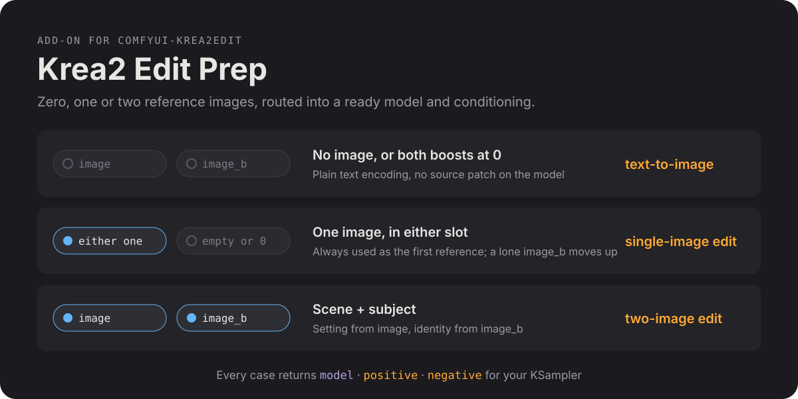
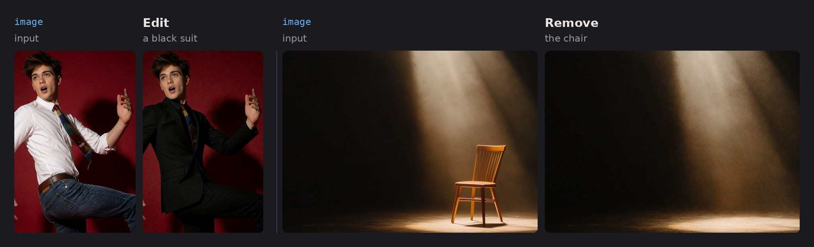

<p align="center">
  
</p>

# GG Krea2

**Krea2 Edit Prep (gg)** turns zero, one or two reference images into a ready `model`, `positive` and `negative` for a KSampler, for Krea 2. It grounds the prompt on the images and adds them to the model as references itself, so no other edit nodes are needed.


*One prompt and seed for all four: "the person from the second image sitting on the chair in the first image, blue backdrop"; the single-image routes reuse it to show what each route keeps. Krea 2 Turbo with the Identity Edit V2 and General Edit V2 LoRAs at 0.5 each, 9 steps, CFG 1, euler / normal, 832 × 1264, `rebalance` 0.7, other node settings at their defaults.*

## Requirements

- ComfyUI with Krea 2 support, the Krea 2 model and its VAE.
- The Krea 2 text encoder (Qwen3-VL, with its vision tower) loaded with type `krea2`.
- For edits, an edit LoRA ([weights](https://huggingface.co/conradlocke/krea2-identity-edit)) applied **before** this node, plus any other LoRAs you use (text-to-image works without one):
  - `krea2_identity_edit_v2` to put a person from one photo into a scene, pose or outfit;
  - `krea2_general_edit_v2` for instruction edits (remove, recolour, relight, backgrounds, objects, text);
  - `krea2_identity_edit_v1_2`, the older Identity Edit V1.2 LoRA, also works, for edits and text-to-image.

  Both V2 LoRAs at full strength cause severe artifacts; we use 0.5 each.

## Install

Search for **GG Krea2** in ComfyUI Manager, or clone it:

```sh
cd ComfyUI/custom_nodes
git clone https://github.com/xducer/comfyui-gg-krea2.git
```

Restart ComfyUI. The node is under **krea2 → gg** as **Krea2 Edit Prep (gg)**.

## Quick reference

The node has a built-in quick reference: select it and click the info button in the toolbar above it, or open it from the node library. It covers six common setups (which image goes where, which settings), one line per control, and what the V1.2 and V2 edit LoRAs do differently. This README has the details and examples.

## Wiring


- **Into the node:** `model` (Krea 2 + edit LoRAs and any other LoRAs), `clip`, `vae`, `latent`, `prompt`, and optionally `image`, `image_b` and their masks.
- **Out to the KSampler:** `model`, `positive` and `negative`.

Connect the same `latent` to the KSampler. Any batch size works. Seed, steps and sampler stay on the KSampler.

**Negative:** connect the node's `negative` straight to the KSampler; no extra ConditioningZeroOut is needed. With `negative` set to **zero**, the output already is the zeroed positive, and at CFG 1 ComfyUI doesn't evaluate the negative at all.

**Rebalance:** turn on `rebalance` to apply the default per-layer weights of Conditioning Krea2 Rebalance by nova452 ([Rebalance-Pack](https://github.com/nova452/Rebalance-Pack)) on every route, to `positive` and to a **grounded** negative, so CFG doesn't amplify it. `rebalance_multiplier` is on the same scale as their node's `multiplier` (which defaults to 4.0) and scales every layer, not just the boosted ones. For other per-layer weights, leave `rebalance` off and put their node between the node's `positive` and the KSampler; with a **grounded** negative at CFG above 1, apply it to `negative` too, or CFG amplifies it.

**Other conditioning nodes** go between the node's `positive` and the KSampler as well.

## The two image slots

`image` is always the first reference and `image_b` the second, whatever your files are called:

| Slot | Role |
| --- | --- |
| `image` (first) | **Scene**: the setting, plus the pose and clothing of any person already in it. Also the slot for single-image edits. |
| `image_b` (second) | **Subject**: the person carried into the scene, usually with their clothing unless the prompt changes it. |

| What arrives | Result |
| --- | --- |
| no image, or both boosts at 0 | Text-to-image: plain text encoding, the model left unpatched (your LoRAs stay applied). |
| one image (the other missing or at boost 0) | Single-image edit. A lone `image_b` moves into the first slot. |
| both | Scene + subject edit. |

With two images, "the first image" in the prompt is `image` and "the second image" is `image_b`. With one image, whichever slot it is in, it is the only image the model sees, so call it "the image".

## Text-to-image in an edit workflow

With no image (or both boosts at 0) the same workflow generates from the prompt alone, so you don't need a separate text-to-image workflow. The node leaves the model unpatched then, but the edit LoRAs stay loaded and still change the look.

With both V2 LoRAs at 0.5, `rebalance` on at a `rebalance_multiplier` of 0.7–0.8 gave us the best overall results. Without an edit LoRA, or with Identity Edit V1.2, 1.0 works better.

The edit LoRAs aren't needed without images, and they change the look. The V2 pair adds skin texture that grows with strength (deeper wrinkles on older faces, about twice as much at 0.5 each) and can change faces; at 0.25 each it stays close to plain Krea 2. Identity Edit V1.2 adds little texture but makes images darker and moodier. Mute them, or lower the V2 pair, for plain Krea 2; or leave them on to keep one workflow for everything.

## Boosts and masks

**A boost sets how closely the result copies that image.**

| Boost | Effect |
| --- | --- |
| 1.0 | Neutral (default). |
| above 1 | Copies that image more closely. With the V2 LoRAs 1.0 is usually enough; try 1.3–1.5 when likeness is weak. Far above 2 it can copy too literally (pasted-in lighting, the reference's pose or backdrop, duplicates). |
| below 1 | Copies it more loosely, so edits take hold more easily. |
| 0 | Leaves that image out entirely. |

**A mask limits that image's boost to the painted area.** Outside it the image keeps the neutral weight. It is not an inpainting mask: the prompt can still change anything anywhere.

- Paint it in the mask editor of the picture's Load Image node (right-click → Open in MaskEditor) and connect that node's `MASK`.
- The boost must differ from 1.0, or the mask has no effect.
- With both images, only `image_b_mask` applies; the scene can't be masked. With one image, that image's own mask applies.
- An empty mask (nothing painted) means the whole image, so leaving `MASK` connected is safe, unless the picture has transparency: Load Image then makes the transparent area the mask.

At 1.0 the identity LoRA usually reproduces the face well already. When you need a stronger boost on an `aligned` image, a face mask keeps it on the face, so the rest of the photo isn't copied too literally (see the board below).

## Positions

**A position sets whether the result keeps that image's layout.** Each image has its own; like the boosts, it follows the image, whichever slot it ends up in. `image` defaults to `aligned`, `image_b` to `beside`.

| Position | Effect |
| --- | --- |
| aligned (trained) | Pinned to the output layout, as the LoRAs were trained. |
| beside (right of target) | Placed next to the canvas: the identity still comes through, but the layout pin is gone, so the person can be restaged more freely. |
| bag of features | Experimental: the image's content without its layout. |

Keep the scene `aligned` so its layout and lighting carry over. For the person, `beside` keeps the likeness but copies much less of the photo's pose and lighting, also at higher boosts; on `aligned` the V2 identity LoRA tends to copy both. For a single-image edit that should keep the picture's layout, use `image` (aligned).


*Same scene, prompt, seed and sampler in all four; `image` stays aligned at 1.0. Only `image_b`'s position, boost and mask change.*

## Grounding and pixels

Each image reaches the model in two ways; `image_use` and `image_b_use` choose which.

| Use | What it carries |
| --- | --- |
| grounding + pixels (default) | Both. |
| grounding only | The text encoder sees the image: objects, outfits, scenes and styles, by meaning. Its layout isn't copied, and the image itself doesn't go into the model, so it is also faster. |
| pixels only | The image itself goes into the model, but the prompt isn't grounded on it. With the V2 LoRAs a face carries without the photo's clothes and background, and a scene keeps its layout. With the Identity Edit V1.2 LoRA it is weak; use **grounding + pixels** there. |

Boost, mask and position apply only to images whose pixels are used. If no image's pixels are used, the model is left unpatched.

An `aligned` face photo whose pixels are used brings its framing and background along; `beside` (the `image_b` default) stops that.

![Three generated inputs (a fluffy white sofa in a crystal landscape, a white shirt and tie with jeans cropped below the chin, and a grey-haired man's face), then three results: scene + face keeps the landscape and puts the grey-haired man in his own dark jacket on the sofa; scene + the stitched outfit and face keeps the landscape and dresses him in the white shirt and tie; the stitched outfit and scene as grounding only with the face as pixels only restages the sofa among crystals, with the grey-haired man in the shirt and tie.](assets/readme/grounding.jpg)

*Prompt "a man sitting on the fluffy white sofa", same seed for all three. Krea 2 Turbo with the Identity Edit V2 and General Edit V2 LoRAs at 0.5 each, 9 steps, CFG 1, euler / normal, 1248 × 832, `rebalance` 0.7. The face is used as `beside` in all three.*

## Recipes

**Put the person from one photo into a scene** (Identity Edit V2)
1. `image` = the scene; `image_b` = the person. Leave the positions at their defaults (scene aligned, person beside).
2. Prompt: *The man from the second image sitting on the chair in the first image.*

**Put the face from one photo onto the person in another** (Identity Edit V2)
1. `image` = the photo with the body, pose, clothes and background to keep.
2. `image_b` = the photo with the face. Leave the defaults.
3. Prompt: *Give the man in the first image the face of the man in the second image. Keep his pose, clothing and the background unchanged.*

The LoRA restages a person; it is not a pixel-exact face swap. The hair stays from the first image unless the prompt asks for it. A higher `image_b_boost` with a face mask changes little.

**Combine an outfit, a scene and a face**
1. Stitch the outfit photo and the scene photo side by side (Image Stitch node) into `image`, with `image_use` on **grounding only**. Crop the outfit photo below the chin: a face in it competes with the face you want, and its expression comes along too.
2. `image_b` = the face photo, with `image_b_use` on **pixels only** and its position on `beside`.
3. Prompt what should happen, e.g. *a lady sitting on the sofa holding a coffee cup*.

The scene is restaged freely. To keep the scene photo's layout instead, put the scene alone in `image` and stitch the (cropped) outfit and face photos into `image_b`, both with default settings. With the Identity Edit V1.2 LoRA the face from a pixels-only image is weaker; **grounding + pixels** for the face helps the likeness but also brings that photo's clothes.

**Edit one picture** (General Edit V2)
Connect only `image` and describe the edit (*change his shirt to a black suit*). At the default boost the face, pose and background usually stay as they are.

**Remove something** (General Edit V2)
Connect only `image` and name what to remove (*remove the chair*). This works at CFG 1 on Turbo. If the object comes back re-rendered instead of removed, use Krea 2 Raw (the non-Turbo model) at CFG ~3 with `negative` set to **grounded**.



*Krea 2 Turbo with the General Edit V2 LoRA, 9 steps, CFG 1, euler / normal, default node settings. Prompts: "Change his shirt to a black suit." and "Remove the chair."*

**An edit that won't take** (General Edit V2)
In a single-image edit, paint the stubborn area (for example the shirt) into that image's mask and set its boost to 0.6–0.8 to loosen it. Keep it above 0, because 0 leaves the image out. Lowering `grounding_px` (for example to 512) also helps an edit take.

**Text-to-image**
Disconnect both images, mute or bypass their Load Image nodes, or set both boosts to 0. See [Text-to-image in an edit workflow](#text-to-image-in-an-edit-workflow) for the LoRA and Rebalance settings we use.

## Other settings

- `negative`: **zero** for CFG 1 (Turbo, the negative isn't evaluated). **grounded** for CFG above 1 (e.g. the Raw model at CFG ~3): an empty prompt on the same images, the trained unconditional. It costs one extra encoder pass.
- `grounding_px`: caps the longest side of each image shown to the text encoder (smaller images are not enlarged; 0 = native size). Lower follows the instruction more, higher keeps identity better; 1024 suits people.
- `fit_mode`: keep `fit`; `crop (legacy)` is for older weights, and masks drift more with it.
- Generate at about 2 MP or less; larger outputs can bleed content from the images or duplicate subjects.

## What's new

**0.3.1 (unreleased)**
- New `image_use` and `image_b_use`: use an image for its grounding only, its pixels only, or both. One image can carry an outfit or scene by meaning while the other carries a face.
- Fixed: streaks along the right or bottom edge at output sizes that aren't a multiple of 16.
- The node moved to **krea2 → gg** in the node menu. Saved workflows are unaffected.
- A built-in quick reference in the node's help panel.

**0.3.0**
- No other node pack needed: the edit engine is included. Saved workflows keep working.
- License changed to GPL-3.0.

Earlier versions: see [CHANGELOG.md](CHANGELOG.md).

## License

GPL-3.0, see [LICENSE](LICENSE). Versions up to 0.2.1 were Apache-2.0.

`engine.py` is derived from [comfyui-krea2edit](https://github.com/lbouaraba/comfyui-krea2edit) by lbouaraba (commit 13ef60f, Apache-2.0, see [LICENSES/Apache-2.0.txt](LICENSES/Apache-2.0.txt)), whose edit forward is adapted from ComfyUI's Krea 2 model (GPL-3.0). The Rebalance weights are from [Rebalance-Pack](https://github.com/nova452/Rebalance-Pack) by nova452 (Apache-2.0).

This pack contains no model weights. The Identity Edit V2 and General Edit V2 LoRAs are free for personal and non-commercial use; commercial use, including selling their outputs, needs a license from their author ([details](https://huggingface.co/conradlocke/krea2-identity-edit)). Krea 2 itself, and the earlier edit LoRAs, are under the Krea 2 Community License.
