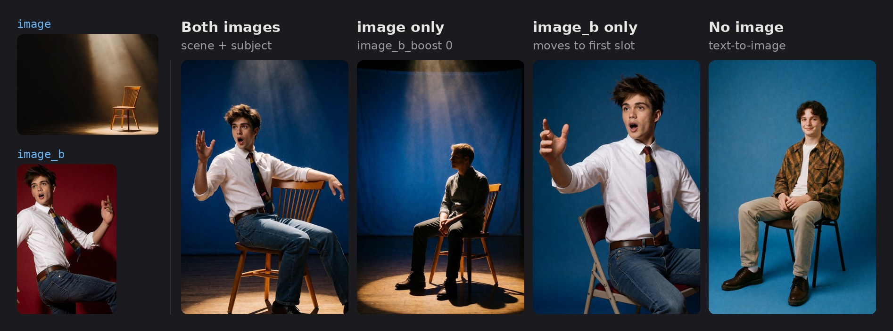
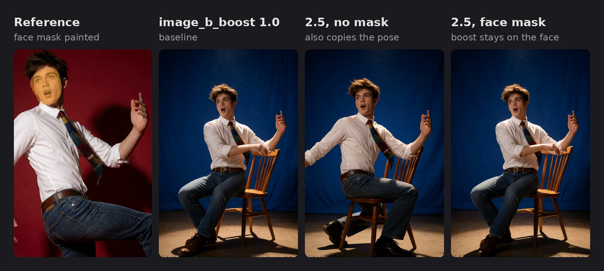

  

# GG Krea2

**Krea2 Edit Prep (gg)** turns zero, one or two reference images into a ready `model`, `positive` and `negative` for a KSampler, for Krea 2 with the [Krea 2 Identity Edit](https://github.com/lbouaraba/comfyui-krea2edit) LoRA. It runs the Krea2 Edit nodes (grounded encode and source patch) internally, so you don't place them yourself.

*One prompt and seed for all four: "the person from the second image sitting on the chair in the first image, blue backdrop". Krea 2 Turbo, 9 steps, CFG 1.*

## Requirements

- [comfyui-krea2edit](https://github.com/lbouaraba/comfyui-krea2edit) installed.
- Krea 2 with the identity edit LoRA applied **before** this node, plus any other LoRAs you use.

## Wiring

- **Into the node:** `model` (Krea 2 + identity LoRA and any other LoRAs), `clip`, `vae`, `latent`, `prompt`, and optionally `image`, `image_b` and their masks.
- **Out to the KSampler:** `model`, `positive` and `negative`.

Connect the same `latent` to the KSampler. Any batch size works. Seed, steps and sampler stay on the KSampler.

**Negative:** connect the node's `negative` straight to the KSampler; no extra ConditioningZeroOut is needed. With `negative` set to **zero**, the output already is the zeroed positive, and at CFG 1 ComfyUI doesn't evaluate the negative at all.

**Rebalance and other conditioning nodes** go between the node's `positive` and the KSampler, for example `positive → Krea2 Rebalance → KSampler.positive`. To turn the rebalance off, bypass it (Ctrl+B). At CFG 1 that is all you need. At CFG above 1 with a **grounded** negative, a rebalance on the positive only is amplified by the guidance as part of the positive/negative difference; compare it with applying the same rebalance to the negative as well.

## The two image slots

The slot names are positions, not your picture numbers. Put any picture in either slot:

| Slot | Role |
| --- | --- |
| `image` (first) | **Scene**: the picture whose setting, pose and clothing you keep. Also the slot for single-image edits. |
| `image_b` (second) | **Subject**: the person whose identity is carried into the scene. |

| What arrives | Result |
| --- | --- |
| no image, or both boosts at 0 | Text-to-image: plain text encoding, model unpatched. |
| one image (the other missing or at boost 0) | Single-image edit. A lone `image_b` moves into the first slot. |
| both | Scene + subject edit. |

In the prompt, "the first image" is `image` and "the second image" is `image_b`.

## Boosts and masks

**A boost sets how closely the result copies that image.**

| Boost | Effect |
| --- | --- |
| 1.0 | Neutral (default). |
| above 1 | Copies that image more closely. Start at 1.3–1.5; far above 2 it copies too literally (pasted-in lighting, stuck-on edges, duplicates). |
| below 1 | Copies it more loosely, so edits take hold more easily. |
| 0 | Leaves that image out entirely. |

**A mask limits that image's boost to the painted area.** Outside it the image keeps the neutral weight. It is not an inpainting mask: the prompt can still change anything anywhere.

- Paint it in the mask editor of the picture's Load Image node (right-click → Open in MaskEditor) and connect that node's `MASK`.
- The boost must differ from 1.0, or the mask has no effect.
- With both images, only `image_b_mask` applies; the scene can't be masked. With one image, that image's own mask applies.
- An empty mask (nothing painted) means the whole image, so leaving `MASK` connected is safe.

At 1.0 the identity LoRA usually reproduces the face well already. When you need a stronger boost, a face mask keeps it on the face, so the rest of the reference (pose, clothing, background) isn't copied too literally:

*Same scene, prompt and seed in all three. Only the boost and the mask change.*

## Recipes

**Put the face from one photo onto the person in another**
1. `image` = the photo with the body, pose, clothes and background to keep.
2. `image_b` = the photo with the face; paint the face (a little past hairline, ears and jaw) and connect its `MASK` to `image_b_mask`.
3. `image_b_boost` 1.0, `image_boost` 1.0, `grounding_px` 1024. If likeness is weak, raise `image_b_boost` to 1.5–2.5; the face mask keeps the rest of that photo from being copied.
4. Prompt: *Give the man in the first image the face of the man in the second image. Keep his pose, clothing and the background unchanged.*

The LoRA restages a person; it is not a pixel-exact face swap. If too much of the face photo bleeds in, lower the boost or tighten the mask.

**Edit one picture and keep the face**
Connect only `image`, paint the face into `image_mask`, set `image_boost` to about 1.3, and describe the edit (*change his shirt to a black suit*).

**An edit that won't take**
Paint the stubborn area (for example the shirt) and set that image's boost to 0.6–0.8 to loosen it. Keep it above 0.

**Text-to-image**
Leave both images unconnected, mute their sources with a Boolean Fast Muter, or set both boosts to 0.

## Other settings

- `negative`: **zero** for CFG 1 (Turbo, the negative isn't evaluated). **grounded** for CFG above 1 (e.g. the Raw model at CFG ~3): an empty prompt on the same images, the trained unconditional. It costs one extra encoder pass.
- `grounding_px`: lower follows the instruction more, higher keeps identity better; 1024 suits people.
- `fit_mode`: keep `fit`; `crop (legacy)` is for older weights, and masks can drift with it.
- Generate at about 2 MP or less; larger outputs can bleed source content or duplicate subjects.
